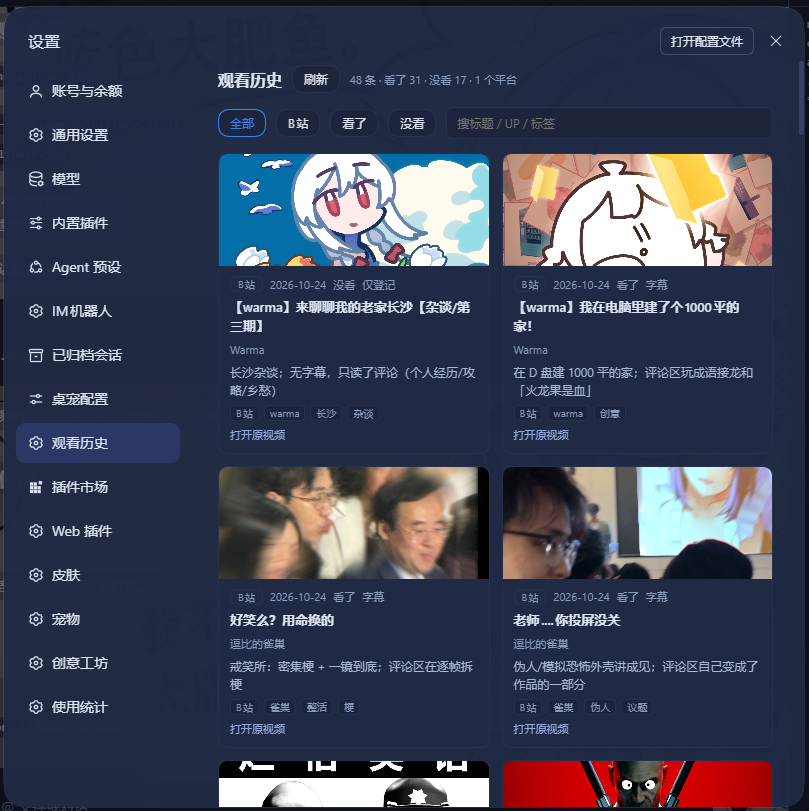
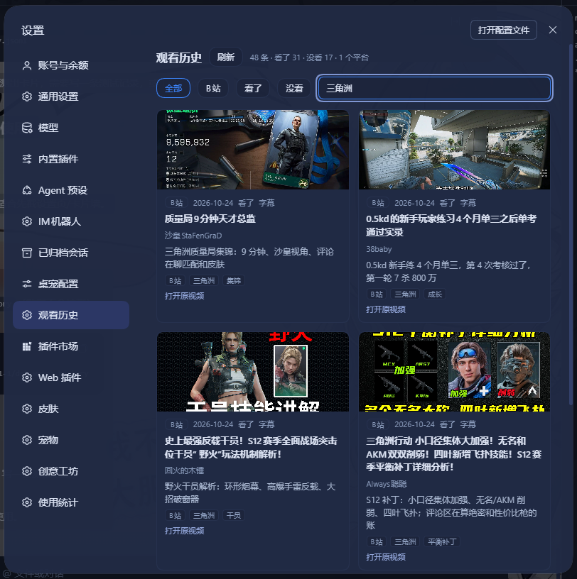

# dsh-watch-history

> 把 Agent 看过的内容记成一份本地账本，在设置页用卡片墙回看。  
> v0.1.1 · [Changelog](CHANGELOG.md)

**适合谁**：用 DSH Agent 刷视频、读帖子，想留下「看过什么、看没看完、一句话感受」的人。

**它是什么**：一个跨平台观看历史插件。记录由 Agent / HTTP 调用写入；插件负责存储、补全元数据、展示卡片。

**要求**：DSH ≥ 0.2.0、Node ≥ 22；安装后重启一次 DSH。

## 截图





## 解决什么问题

Agent 看完一个视频，信息通常散在对话里：标题、链接、为什么值得、看没看完。下次想回看，只能翻聊天记录。

这个插件把这件事收成一条记录：

```text
Agent 看完 / 学完
→ 调 watch_history_add（或 POST /api/watch-history）
→ 写 history.jsonl
→ 设置页出现卡片
```

它不负责“发现新内容”，只负责“看过的别丢”。

## 功能

- **统一记录**：不同平台的「看过什么」写进同一份 JSONL
- **卡片墙**：封面、标题、UP/作者、标签、平台、看了/没看、观看方式
- **筛选与搜索**：按平台、看了/没看过滤，按标题/UP/标签搜索
- **任意平台**：`platform` 只是字符串，不要求插件提前支持
- **元数据补全**：B站/GitHub 用公开接口，抖音/快手/小红书/贴吧/小黑盒读公开页面 OG；补不上就留空
- **三种写入**：AI 工具 `watch_history_add`、带 token 的 HTTP API、CLI 脚本
- **本地鉴权**：同源校验 + 随机 token；token 只用于本机请求
- **不碰账号**：不需要 B站登录，不保存 cookie，不抓推荐流

## 边界

- 不主动发现新视频、不监控浏览器
- 不保存平台账号、cookie、SESSDATA
- 不做评论、点赞、投币、私信
- **append-only**：同一条记录调用两次会写两条，不去重

## 安装

### 桌面版：插件管理器

DSH → **Settings → Plugins → Add plugin**，填：

```text
https://github.com/H-Y-1-1/dsh-watch-history
```

装完重启 DSH，打开 **设置 → 观看历史**。

> 桌面版 profile 由 Electron App 独占管理，不要用 `dsh plugin --profile desktop add`；CLI 会报
> `profile "desktop" is managed exclusively by the Electron application`。

### Web / headless profile

```bash
dsh plugin --profile web add github:H-Y-1-1/dsh-watch-history
```

然后重启对应 profile。

### 本地开发

把插件目录 link 进 profile 后重启 DSH；静态页可单独生成：

```bash
node tools/render.mjs
```

## 快速开始

1. 安装 → 重启 → 打开「观看历史」；
2. 默认历史是空的，因为数据目录是新文件；
3. 用 `watch_history_add` 写第一条；
4. 刷新设置页，卡片出现。

如果你已经有自己的 JSONL，在 `config.json` 里把 `dataFile` 指过去。

## 写入记录

### AI 工具

```text
watch_history_add
  platform: bilibili
  content_id: BV1xx...
  title: 标题
  started_at: 2026-10-25T12:00:00+08:00
  status: watched        # watched / metadata_only / reference_only
  seen: true             # 不填按 status 推导
  view_mode: subtitle    # full_playback / frames / subtitle / ai_review / metadata / reference
  one_liner: 一句话感受
  tags: ["游戏", "整活"]
```

B站记录缺 `url` / `cover_url` 时，插件会用公开 view API 补；其他平台可以直接传 `cover_url`。

### HTTP

```text
GET  /api/watch-history/bootstrap        → token + HttpOnly cookie
GET  /api/watch-history?limit=&offset=   → 需要 token/cookie
POST /api/watch-history                  → 需要 token/cookie + application/json
GET  /api/watch-history/fallback         → 通用占位图
```

```bash
curl http://127.0.0.1:<port>/api/watch-history/bootstrap

curl -X POST http://127.0.0.1:<port>/api/watch-history \
  -H "Content-Type: application/json" \
  -H "X-Watch-History-Token: <token>" \
  -d '{"platform":"bilibili","content_id":"BV1xx","title":"标题"}'
```

> **鉴权边界**：API 只接受 Host 为本机回环地址的请求，并校验 Origin/Referer、Sec-Fetch-Site
> 与 32 字节随机 token，用于阻止网页跨站写入。它防不了本机其他程序——任何本地进程都能调用
> bootstrap 拿 token。请确保端口不对公网开放；若走反向代理，需把 Host 重写为 `127.0.0.1`
> 并自行加认证层，否则会被同源校验拒绝。

### 脚本

```bash
node tools/add.mjs out/record.json
```

CLI 写入 `WATCH_HISTORY_FILE`、`config.json` 的 `dataFile`，都没有时写
`~/.dsh/watch-history/history.jsonl`。

## 数据格式

完整 schema 见 [schema/history.schema.json](schema/history.schema.json)。

| 字段 | 必填 | 说明 |
|---|---|---|
| `platform` | 是 | 任意字符串，如 `bilibili` / `github` / `xiaohongshu` |
| `content_id` | 是 | 平台内容 ID；B站 BV 号 |
| `title` | 是 | 标题 |
| `started_at` | 否 | ISO 时间，默认现在 |
| `status` | 否 | `watched` / `metadata_only` / `reference_only` |
| `seen` | 否 | 看了/没看；不填按 status 推导 |
| `view_mode` | 否 | 观看方式 |
| `url` / `creator` / `cover_url` | 否 | 原链接、作者、封面 |
| `media_type` | 否 | `video` / `post` / `thread` / `repo` |
| `one_liner` / `tags` | 否 | 一句话感受、标签数组 |
| `source_agent` | 否 | 写入者标识 |

存储是 append-only JSONL，一行一条；排序和筛选在读取时做。

## 元数据补全

补全优先级：

```text
记录自带字段 > 内置适配器 > Provider > 声明式配置 > 占位图
```

- **内置**：B站 view API、GitHub API、抖音/快手/小红书/贴吧/小黑盒页面 OG
- **Provider**：POST `resolveMedia` 的外部元数据服务，默认不启用，需要你自己搭
- **声明式**：URL 正则 + API 模板 + 点路径字段，默认不启用

Provider / 声明式的请求格式与字段见 [CONTRACT.md](CONTRACT.md)。

## 配置

`config.json` 放在插件目录下（与 `package.json` 同级），可用 `WATCH_HISTORY_CONFIG` 指向别处。
复制 `config.example.json` 修改：

```json
{
  "dataFile": "",
  "fallbackImage": "",
  "provider": {
    "url": "",
    "timeout_ms": 3000,
    "headers": {}
  },
  "adapters": []
}
```

| 字段 | 说明 |
|---|---|
| `dataFile` | 历史 JSONL 路径；空则 `~/.dsh/watch-history/history.jsonl` |
| `fallbackImage` | 可选的本地兜底图；空则 `assets/fallback.svg` |
| `provider` | 外部元数据服务；默认关闭 |
| `adapters` | 声明式平台配置；默认关闭 |

环境变量：`WATCH_HISTORY_CONFIG` 指定配置文件；`WATCH_HISTORY_FILE` 在没有 `dataFile` 时覆盖数据路径。

> 0.1.1 起兼容带 UTF-8 BOM 的 `config.json`；0.1.0 会静默忽略整份配置。

## 它是怎么跑的

```text
DSH 插件 host
  ├─ /api/watch-history 路由（同源 + token）
  ├─ watch_history_add 工具
  └─ 读 history.jsonl，做排序/筛选/统计

DSH client
  └─ 设置页「观看历史」：bootstrap → 拉数据 → 卡片墙
```

只监听本机；不保存平台凭据；B站/GitHub 补全失败就留空，不影响记录写入。

## 常见问题

**装完是空历史？**  
默认数据目录是新文件；写一条记录，或把 `dataFile` 指到你已有的 JSONL。

**设置页显示「无权限」？**  
确认插件是 0.1.1；设置页会先 bootstrap 拿 token。仍失败就看 DSH 日志里的 401/403。

**封面是蓝色占位图？**  
记录没有 `cover_url`，或图片加载失败。公开仓库默认 `assets/fallback.svg`；本地可用 `fallbackImage` 换图。

**B站封面/标题没补上？**  
B站接口可能超时或风控；5 秒后保留空值，记录仍会写入。

**重复卡片？**  
append-only，不去重；同一条调用两次会有两张卡。

**桌面版 CLI 装不上？**  
正常，desktop profile 由 App 管理；用 Settings → Plugins。

## 隐私与安全

- 不收集遥测，不上传历史
- 不需要 B站账号/cookie
- 补全只访问公开接口或公开页面；失败即降级
- 公开仓库不包含 `config.json`、本地历史、私人图片
- 不要把这个端口直接暴露公网；需要公网访问时，反代必须重写 Host 并额外加认证

## 开发与测试

```bash
npm test
```

覆盖：store/query 排序、Provider/声明式补字段、鉴权矩阵、config BOM/坏 JSON（纯 Node `assert` 脚本）。

目录：

```text
index.js              host 插件入口（路由 + 工具）
client.js             设置页客户端
src/                  store / auth / add / resolve / provider / declarative
tools/                add / render / serve / watch / migrate-seen
schema/               JSON Schema
test/                 测试脚本
assets/fallback.svg   通用占位图
```

## License

MIT。`assets/fallback.svg` 为代码自带通用占位图。
